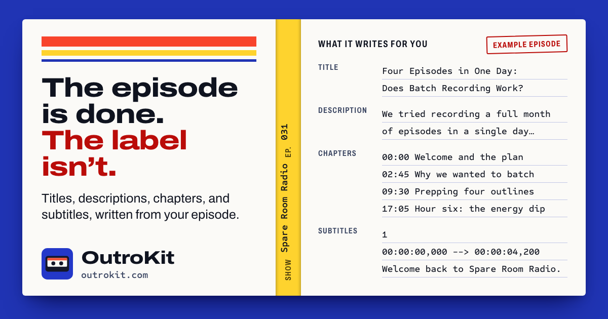
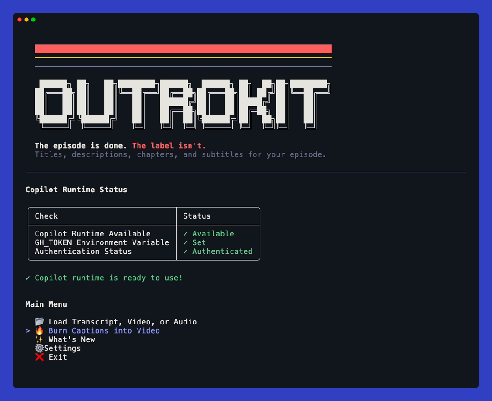
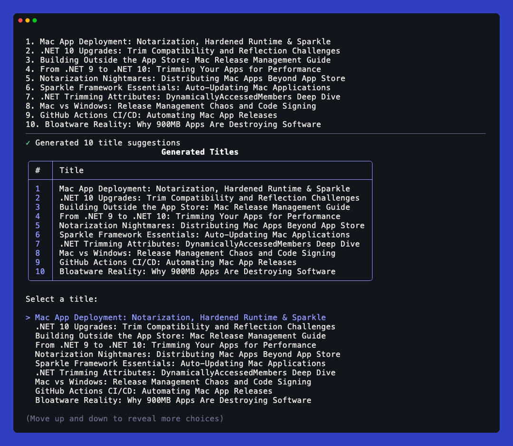

# 📼 OutroKit

OutroKit writes the titles, descriptions, chapters, and SRT subtitles for your episode from its transcript, video, or audio, using AI powered by the GitHub Copilot SDK. It works for podcasts and videos alike.

> OutroKit was called Podcast Metadata Generator, and its NuGet package is now `OutroKit`. The old `PodcastMetadataGenerator` package still works and tells you how to switch: run `dnx OutroKit`, or if you installed it as a tool, run `dotnet tool uninstall -g PodcastMetadataGenerator` and then `dotnet tool install -g OutroKit`. Your settings carry over.


**New here?** The [step-by-step install and usage guide](https://outrokit.com/) at **outrokit.com** walks through everything, starting from opening a terminal.







## ✨ Features

- **🎯 Title Generation** - Get multiple creative title suggestions for your episode
- **🎨 Title Styles** - Pick a style (balanced, descriptive, curiosity hook, question, how-to, playful, professional, SEO, or mixed) each time you generate titles
- **📝 Description Generation** - Create short, medium, and long descriptions optimized for different platforms, picking which lengths to generate each time
- **📑 Chapter Generation** - Auto-generate YouTube-compatible chapter markers with timestamps
- **🎬 SRT Conversion** - Convert transcripts to valid SRT subtitle format
- **🧹 Auto Fix SRT** - Check an `.srt` file for readability issues, apply safe fixes, and save a corrected copy without changing the original
- **🔄 Multiple Transcript Formats** - Support for Zencastr, time-range, SRT formats, and plain text
- **🎧 Video & Audio Transcription** - Start from a video or audio file (`.mp3`, `.wav`) and generate an SRT transcript locally with ffmpeg and Whisper.net
- **🔥 Burn Captions into Video** - Draw an `.srt`, `.vtt`, `.ass`, or `.ssa` captions file into the picture of a video with four appearance choices. For other caption formats, or captions that need more work first, use [CaptionStack](https://captionstack.app/)
- **📂 File Browser** - Built-in file browser or drag-and-drop support
- **⚡ Streaming Responses** - Watch AI responses generate in real-time
- **📋 Copy to Clipboard** - Copy titles, descriptions, chapters, or everything at once; finished output is printed unwrapped so it also selects cleanly in the terminal
- **💾 Choose what to save** - Save selected titles, descriptions, chapters, SRT subtitles, and the manifest, or everything at once; the suggested output folder is next to the transcript unless you configured another folder in Settings
- **🤖 Model Selection** - Choose from multiple AI models (GPT-5, Claude, Gemini)
- **⚙️ Configurable Settings** - Customize generation parameters and save preferences
- **✨ What's New** - See full details for the latest release and compact, title-only updates for older releases from the main menu
- **Agent-callable commands** - Generate metadata, transcribe, convert or fix captions, burn captions, and extract or replace audio without interactive menus, with JSON results and safe explicit output paths

## 📋 Prerequisites

- [.NET 10.0 SDK](https://dotnet.microsoft.com/download) or later
- A GitHub Copilot account and authentication, unless using BYOK, for the interactive app and AI metadata commands. The free Copilot plan works
- [GitHub Copilot CLI](https://docs.github.com/en/copilot/how-tos/set-up/install-copilot-cli) installed for the interactive app and AI metadata commands (see below)
- [ffmpeg](https://ffmpeg.org/download.html) available on `PATH`, or its executable path configured in Settings (only needed to transcribe video or audio files and to burn captions into video)
  - Burning captions needs an ffmpeg built with libass, which provides the `subtitles` filter. Homebrew's standard `ffmpeg` formula leaves it out; `brew install ffmpeg-full` includes it

The app reaches Copilot through the Copilot CLI installed on your computer, on every system and whether you run the NuGet tool or build from source. It does not bundle a Copilot runtime. Make sure `copilot` is on your `PATH`, or set `COPILOT_CLI_PATH` to the executable. If the app cannot find it, it shows how to install it. The noninteractive transcription, caption, subtitle conversion, audio, and Whisper model commands run without a Copilot readiness check or authentication.

### Installing GitHub Copilot CLI

**macOS and Linux (Homebrew):**
```bash
brew install copilot-cli
```

**Windows (WinGet):**
```powershell
winget install GitHub.Copilot
```

**All platforms (npm, requires Node.js 22+):**
```bash
npm install -g @github/copilot
```

**macOS and Linux (install script):**
```bash
curl -fsSL https://gh.io/copilot-install | bash
```

Then authenticate:
```bash
copilot
# Type /login and follow the prompts
```

## 🚀 Installation

### Just run it with .NET 10+ (Recommended)

```bash
dnx OutroKit
```

### As a .NET Tool

```bash
dotnet tool install -g OutroKit
```

Then start it with `outrokit`.

### From Source

```bash
git clone https://github.com/jamesmontemagno/outrokit.git
cd outrokit
dotnet build PodcastMetadataGenerator.sln
```

## 📚 Additional Docs

- [Using GitHub Copilot SDK built-in APIs in .NET](docs/copilot-sdk-dotnet-built-in-apis.md)

## Agent skills in the NuGet package

OutroKit bundles focused [Agent Skills](https://agentskills.io/) alongside the
tool, following the [NuGet skill-delivery convention](https://devblogs.microsoft.com/dotnet/delivering-skills-in-nuget-packages/).
The `OutroKit` and legacy `PodcastMetadataGenerator` packages carry the same files
at `skills/<name>/SKILL.md`, matched to the app version:

| Skill | Helps your agent with |
|-------|-----------------------|
| `outrokit-episode-metadata` | Agent-callable titles, descriptions, and publishing-kit JSON |
| `outrokit-youtube-chapters` | Real topic-boundary timestamps and YouTube chapter publishing checks |
| `outrokit-captions` | Local transcription, SRT readability fixes, and safe styled caption burns |
| `outrokit-audio` | Original-audio extraction and processed-track replacement without re-encoding the picture |

These skills tell your agent how to invoke the [noninteractive commands](#agent-cli)
below, interpret their JSON responses, and escalate decisions to you. Starting
OutroKit without a subcommand still opens the interactive app. Installing the
tool does **not** automatically register skills with your editor or load them
into the app's Copilot SDK sessions.

For a published version containing skills, the article's `dotnet-inspect` tool
can discover them directly from NuGet:

```bash
dotnet tool install -g dotnet-inspect
dotnet-inspect package OutroKit -S Skills
```

To make them available to Copilot in your own repository, download the `.nupkg`
for the version you use from NuGet and extract its `skills/` directory, then copy
the desired skill folders into your repository's `.github/skills/`. For example,
with `unzip` on macOS or Linux (replace `<version>` with your package version):

```bash
unzip "OutroKit.<version>.nupkg" 'skills/*' -d ./outrokit-package
mkdir -p .github/skills
cp -R ./outrokit-package/skills/outrokit-* .github/skills/
```

Review the instructions before enabling them, check for existing folders before
copying, and do not overwrite customized skills without review. Use only packages
from maintainers you trust. Refresh the copied skills when updating OutroKit.
Because this is a **tool** package, do not add it as a `PackageReference` just to
obtain skills; project-dependency skill installers are not the installation path
for this package. From a source checkout, the same documents live in [`skills/`](skills/).

## 📖 Usage

### Agent CLI

Use `outrokit --help` and `outrokit <command> --help` to discover the installed
version's options. Replace `outrokit` with `dnx OutroKit` to run without a global
installation. Existing `outrokit` and `outrokit /path/to/transcript.txt` usage
still opens the interactive app.

| Command | Result |
|---------|--------|
| `metadata <transcript>` | Requested titles, description lengths, and/or checked chapters as JSON |
| `transcribe <media> --output <file.srt>` | Local Whisper transcription; requires an existing model and ffmpeg |
| `srt convert <transcript> --output <file.srt>` | SRT from existing timestamps, with conversion warnings |
| `captions check <captions>` | Readability report for SRT, WebVTT, ASS, or SSA |
| `captions fix <captions.srt> --output <fixed.srt>` | Separate corrected SRT and remaining findings |
| `captions burn <video> --captions <file> --output <video.mp4>` | Captioned H.264 video, with optional style and safe fixes |
| `audio extract <video> --output <audio.wav>` | Original audio; WAV, MP3, M4A, or FLAC output |
| `audio replace <video> --audio <track> --output <video.mp4>` | Original picture with AAC replacement audio, padded or trimmed to the video length |
| `models list` / `models download --whisper-model Base` | Whisper model catalog / explicitly downloaded and initialized model path |

For example, start with a timed transcript and select only the metadata needed:

```bash
outrokit metadata "/path/to/episode.srt" \
  --artifacts Titles Descriptions Chapters --lengths Short Medium \
  --style Seo --context "This episode's guest and subject" \
  --output "/path/to/episode-metadata.json"

outrokit captions check "/path/to/episode.srt"
outrokit captions fix "/path/to/episode.srt" --output "/path/to/episode-fixed.srt"
outrokit captions burn "/path/to/episode.mp4" \
  --captions "/path/to/episode-fixed.srt" --output "/path/to/episode-captioned.mp4" \
  --appearance ContrastPanel --size Large --position Bottom --fix
```

Metadata defaults to **Titles and Descriptions**, with all three description
lengths. Use `--artifacts` to select `Titles`, `Descriptions`, and/or `Chapters`,
and `--lengths` to select `Short`, `Medium`, and/or `Long`. Titles are suggestions:
the command never silently picks one. To condition descriptions on your choice,
pass `--title "Your selected title"` in a descriptions invocation.

Metadata accepts transcripts, not media. Chapters and SRT conversion require
real timestamps; untimed chapter requests fail before contacting AI. Chapters
are checked for valid times, a zero start, at least three markers, 10-second
minimum durations including the final chapter, transcript-supported starts, and
the configured title word limit. Review whether the boundaries actually match
the topics and final edited video.

Download a Whisper model explicitly if one is not already installed:

```bash
outrokit models download --whisper-model Base
outrokit transcribe "/path/to/episode.mp4" --output "/path/to/episode.srt" \
  --whisper-model-path "/path/returned/by/download/ggml-base.bin"
```

Downloads do not save app preferences. Transcription never implicitly downloads
a missing model. Local commands do not need Copilot authentication; only metadata
uses AI and sends transcript content to the configured provider.

**Response contract.** Each command emits one JSON object on stdout:
`{"success":true,"command":"...","result":{...},"error":null}`. Failures set
`success:false` and provide `error.code`, `error.message`, and optional
`error.details`; diagnostics also go to stderr. Help and version are plain text.
Metadata is in `result.metadata` (`titles`, `descriptions`, `chapters`);
descriptions are keyed by `Short`, `Medium`, and `Long`. Saved metadata paths
are in `result.savedFiles`; other file-producing commands return `result.output`.
Metadata's optional `.json` output contains `input`, `model`, and `metadata`,
not the response envelope and not separate text exports.

| Exit code | Meaning |
|-----------|---------|
| `0` | Operation completed; inspect any report or warnings before publishing |
| `1` | Operation failed |
| `2` | Invalid arguments, input, or settings |
| `3` | SDK permission needs a user decision |
| `4` | Caption quality findings remain |
| `130` | Cancelled or timeout expired |

`captions fix` can save a corrected file and still return **4** if findings
remain; inspect its `result.output` and `result.report`. Burns with findings
are blocked without writing video: use `--fix` for safe SRT/WebVTT fixes and
only add `--allow-issues` after reviewing and explicitly accepting remaining
findings. ASS/SSA keep their embedded styling; appearance overrides and `--fix`
are rejected for those formats.

**Safety and settings.** Every writer requires a separate destination; metadata
can instead return JSON only on stdout. Existing outputs require explicit
`--overwrite`, and inputs cannot be overwritten even through an output symlink.
Failed or cancelled writes leave existing files unchanged. `--settings` reads
an optional settings file; invalid files fail rather than silently falling back.
CLI overrides do not save preferences. Use `--ffmpeg`, `--model` (metadata), and
`--timeout-seconds` as needed; the default timeout is 1800 seconds and the maximum
is 86400. Ctrl+C cancels an active command.

Metadata sessions disable tools for transcript-only generation. If the SDK
still requests permission, exit **3** returns the exact request description and
ID in `error.details`. The agent must ask you to approve or deny it. Retry with
`--approve-permission <id>` only after approval, or `--deny-permission <id>` after
denial if you want to continue with that action rejected. A decision is consumed
once for that matching request, never applied to other actions; stopping without
retrying is also safe.

### Console App - Interactive Mode

```bash
# If installed as a tool:
outrokit

# Or from source:
cd src/Console
dotnet run
```

### Console App - With a Transcript File

```bash
outrokit /path/to/transcript.txt

# Or from source:
dotnet run -- /path/to/transcript.txt
```

### Console App - With a Video or Audio File

Open **Settings → Transcription Settings**, choose a Whisper GGML model, then download and initialize it. After setup, select **Load Transcript, Video, or Audio → Video or audio file**, or pass the file on the command line:

```bash
outrokit /path/to/episode.mp4
outrokit /path/to/episode.mp3
```

Supported video formats are `.mp4`, `.mov`, `.mkv`, `.avi`, `.webm`, `.m4v`, `.wmv`, `.mpeg`, and `.mpg`. Supported audio formats are `.mp3`, `.wav`, `.wave`, `.m4a`, `.aac`, `.flac`, `.ogg`, `.opus`, and `.mp2`.

The app checks the file for an audio track with ffmpeg, asks where to save the `.srt`, transcribes the audio locally, and loads that SRT into the existing metadata flow. Model downloads and transcription can take a while; press **Ctrl+C** to cancel either one and return to the menu.

Models are downloaded from the Whisper.net Hugging Face repository into `~/.podcast-metadata-generator/models`. Smaller models are faster and use less memory; larger models generally improve accuracy. English (`.en`) variants only transcribe English, while the other models are multilingual.

### Console App - Auto Fix SRT

Select **Auto Fix SRT** from the main menu and choose an `.srt` file. OutroKit checks caption timing and readability, applies safe fixes, and suggests a `<filename>-fixed.srt` file next to the original. The original is never changed; issues that cannot be safely fixed are reported for manual review.

### Console App - Save Results

Choose **Save Results** from the main menu to select the generated titles, individual descriptions, chapters, SRT subtitles, and manifest to save. Choose **Everything** to save all available results. The output folder defaults to the folder containing the loaded transcript; a custom **Output Directory** set under Settings takes precedence, and you can edit the folder for each save. If the generated SRT would overwrite the source transcript, OutroKit saves it as a separate `*_subtitles.srt` file.

### Console App - Burn Captions into a Video

Select **Burn Captions into Video** from the main menu, then choose a video and a captions file (`.srt`, `.vtt`, `.ass`, or `.ssa`). No transcript needs to be loaded, and an SRT made by the app from the same video works as the captions file.

Before burning, the app checks caption timing and readability and reports invalid times, overlaps, empty cues, short durations, long lines, too many lines, and fast reading speeds. For SRT and WebVTT files, it can safely clean whitespace, remove empty cues, rewrap text, trim suitable overlaps, and extend captions into available time. Fixes are applied only to a temporary copy used for the burn; the original caption file is never changed. Remaining findings can be reviewed manually or left unchanged. The app then asks you to confirm the caption appearance, text size (Small, Medium, or Large), and position (Bottom or Top), then where to save the result. Choose Classic Outline, Contrast Panel, Bold Impact, or Clean Shadow; Classic Outline is the default. The default output is `<video name>-captioned` next to the original, and the original video is never overwritten. Captions are sized to the video, so they look the same at 720p and 4K and stay proportionate on portrait video. An `.ass` or `.ssa` file keeps its own fonts, sizes, and positions.

Burning captions re-encodes the picture as H.264, so it takes a while on long videos. The result is saved as `.mp4`, `.mov`, `.mkv`, or `.m4v`; a source in another format is saved as `.mp4`. Audio is copied unchanged when the format stays the same and converted to AAC otherwise. Press **Ctrl+C** to cancel and return to the menu; a cancelled or failed burn saves nothing and leaves an existing file as it was.

Captions in another format, such as YouTube's `.sbv` or `.ttml`? [CaptionStack](https://captionstack.app/) converts caption files for free in your browser, and is the place to go when captions need more work before you burn them in.

This feature needs an ffmpeg that includes libass. If yours does not, the app says so and offers to switch to another one. With Homebrew:

```bash
brew install ffmpeg-full
# It is installed beside the standard ffmpeg, not on PATH. Use this as the ffmpeg path:
echo "$(brew --prefix ffmpeg-full)/bin/ffmpeg"
```

## 🌐 Blazor Demo (Local Only)

A web UI demo is included for local development and presentations.

> ⚠️ **Local Use Only**: The Blazor app uses your local Copilot authentication and is not designed for deployment or multi-user access.

### Running the Blazor Demo

```bash
# From repository root
cd src/Blazor
dotnet run
```

Then open https://localhost:5001 in your browser.

### Features
- Drag-and-drop file upload
- Real-time streaming AI output
- Tabbed results view
- Settings persistence via localStorage

### Title Styles

| Style | What you get |
|-------|--------------|
| Balanced | Engaging, descriptive, and SEO-friendly |
| Descriptive | Clear and straightforward, no hype |
| Curiosity Hook | Teases a hook that makes people want to listen |
| Question | Phrased as a question the episode answers |
| How-To / Educational | Outcome-focused: how-to, guide, lessons learned |
| Playful | Witty, with wordplay or humor |
| Professional | Polished and authoritative |
| SEO Keywords | Leads with the terms people search for |
| Mixed Variety | A different style for each title |

Set the default under **Settings → Generation Settings → Title Settings** (console) or on the **Settings** page (Blazor). The default is preselected whenever you generate titles, and you can choose a different style for that run.

### Copying Results (Console)

When a generation finishes, the console offers a **Copy to clipboard** menu for the selected title, all titles, each description, chapters, or everything. The same menu is available from the main menu once you have results. On Linux, clipboard access requires `xsel`.

## 🌍 Website

The guide at [outrokit.com](https://outrokit.com/) lives in [`site/`](site/) as plain HTML, CSS, and JavaScript with no build step. Pushing changes under `site/` to `main` deploys it through the [Pages workflow](.github/workflows/pages.yml).

To preview it locally:

```bash
cd site
python3 -m http.server 4173
```

Then open http://localhost:4173.

The site is served at outrokit.com through the custom domain in the repository's Pages settings.

The image shown when the link is shared is `site/og.png`. It is a 1200×630 screenshot of [`design/og-image.html`](design/og-image.html), which uses the site's fonts and colors. To regenerate it after an edit, with Chrome or Edge:

```bash
"/Applications/Google Chrome.app/Contents/MacOS/Google Chrome" --headless --hide-scrollbars \
  --force-device-scale-factor=1 --window-size=1200,630 \
  --screenshot="$PWD/site/og.png" "file://$PWD/design/og-image.html"
```

The hype video that announces a release is made in the same style from [`design/hype-video/`](design/hype-video/). Its [README](design/hype-video/README.md) covers how to render it and how to update it for the next release.

The browser can keep running after the file is written; stop it with Ctrl+C.

## 🎯 Supported Transcript Formats

### Zencastr Format
```
00:00.15
James
Hello and welcome to the show.

1:02:15.50
Frank
Thanks for having me!
```

Each turn is a timestamp line (`MM:SS.cc` or `H:MM:SS.cc`), a speaker line, and its text. These transcripts have no end times, so a caption runs until the next later turn starts. When people talk over each other, turns can be listed slightly out of order; `srt convert` sorts them without moving any timestamp, and combines turns with the same start into one caption with a line for each speaker. Both are reported in `warnings`.

### Time-Range Format
```
00:00:00 - 00:00:15
Hello and welcome to the show.

00:00:15 - 00:00:30
Thanks for having me!
```

### SRT Format
```
1
00:00:00,000 --> 00:00:15,000
Hello and welcome to the show.

2
00:00:15,000 --> 00:00:30,000
Thanks for having me!
```

### Plain Text
Any text file without timestamps will be processed as plain text. Note: Chapter generation and SRT conversion require timestamps.

## 📁 Output Files

When you save results, the following files are generated:

| File | Description |
|------|-------------|
| `titles.txt` | List of generated title suggestions |
| `description-short.txt` | Short description (~50 words) |
| `description-medium.txt` | Medium description (~150 words) |
| `description-long.txt` | Long description (~300 words) |
| `chapters.txt` | YouTube-compatible chapter markers |
| `subtitles.srt` | SRT subtitle file |
| `manifest.json` | JSON manifest with all metadata |

## ⚙️ Configuration

Access settings from the main menu to configure:

### General Settings
- **AI Model** - Select from available Copilot models (dynamically fetched from CLI)
- **ffmpeg Path** - Executable path or command used to check video and audio files, extract 16 kHz mono audio, and burn captions into video
- **Whisper GGML Model** - Select, download, and initialize a local Whisper.net model for transcription
- **Caption Appearance, Size, and Position** - Default appearance (default: Classic Outline), text size (default: Medium), and position (default: Bottom) for captions burned into video. You are asked to confirm or change them each time you burn captions
- **Output Directory** - Default location for saved files
- **Show Name** - The name of your show (used in prompts for better context)
- **Host Names** - Host names (used in prompts)
- **Episode Context** - Add guest names, topics, or other context to improve generation

### Generation Settings
- **Title Count** - Number of title suggestions to generate (default: 5)
- **Title Max Words** - Maximum words per title (default: 10)
- **Title Style** - Default style for generated titles (default: Balanced). You are asked to confirm or change it each time you generate titles or all metadata
- **Description Lengths** - Word counts for short/medium/long descriptions (default: 50/150/300)
- **Chapter Range** - Min/max chapters to generate (default: 3-12)
- **Chapters per 30 min** - Target density of chapters (default: 5)
- **Chapter Title Words** - Max words per chapter title (default: 8)

Settings are automatically saved to `~/.podcast-metadata-generator/settings.json`.

## 🏗️ Project Structure

```
outrokit/
├── PodcastMetadataGenerator.sln     # Solution file
├── src/
│   ├── Core/                        # Shared class library
│   │   ├── Models/
│   │   │   ├── AppSettings.cs       # Configuration and generation settings
│   │   │   ├── CaptionStyle.cs      # Caption size and position options
│   │   │   ├── GenerationResult.cs  # Results container
│   │   │   ├── Manifest.cs          # JSON manifest structure
│   │   │   ├── TitleStyle.cs        # Title style options and prompt guidance
│   │   │   ├── Transcript.cs        # Transcript model
│   │   │   └── TranscriptSegment.cs # Segment model
│   │   ├── Services/
│   │   │   ├── CaptionBurnService.cs   # Burns captions into video with ffmpeg
│   │   │   ├── CopilotAuthService.cs   # CLI authentication checks
│   │   │   ├── FfmpegRunner.cs         # Shared ffmpeg process launcher
│   │   │   ├── MetadataGenerator.cs    # AI generation via Copilot SDK
│   │   │   ├── OutputService.cs        # File output handling
│   │   │   ├── SettingsService.cs      # Settings persistence
│   │   │   ├── SrtConverter.cs         # SRT format conversion
│   │   │   └── TranscriptParser.cs     # Multi-format transcript parsing
│   │   └── Prompts/
│   │       └── PromptTemplates.cs      # AI prompt templates
│   ├── Console/                     # Console application
│   │   ├── UI/
│   │   │   ├── AppWorkflow.cs          # Main application workflow
│   │   │   ├── ConsoleUI.cs            # Spectre.Console UI helpers
│   │   │   └── WhatsNew.cs             # Entries for the What's New screen
│   │   └── Program.cs                  # Console entry point
│   └── Blazor/                      # Blazor Server demo (local only)
│       ├── Components/
│       │   ├── Layout/                 # MainLayout, NavMenu
│       │   └── Pages/                  # Home, Generate, Settings
│       ├── wwwroot/
│       │   └── css/app.css
│       └── Program.cs                  # Blazor entry point
├── tests/                           # xUnit tests, run on Linux, Windows, and macOS in CI
└── data/                            # Sample transcripts
```

## 🤝 Contributing

Contributions are welcome! Please see [CONTRIBUTING.md](CONTRIBUTING.md) for guidelines.

1. Fork the repository
2. Create your feature branch (`git checkout -b feature/amazing-feature`)
3. Commit your changes (`git commit -m 'Add some amazing feature'`)
4. Push to the branch (`git push origin feature/amazing-feature`)
5. Open a Pull Request

## 📄 License

This project is licensed under the MIT License - see the [LICENSE](LICENSE) file for details.

## 🙏 Acknowledgments

- [GitHub Copilot SDK](https://github.com/github/copilot-sdk) for AI integration
- [Spectre.Console](https://spectreconsole.net/) for the beautiful terminal UI
- Inspired by [jamesmontemagno/app-podcast-assistant](https://github.com/jamesmontemagno/app-podcast-assistant)
